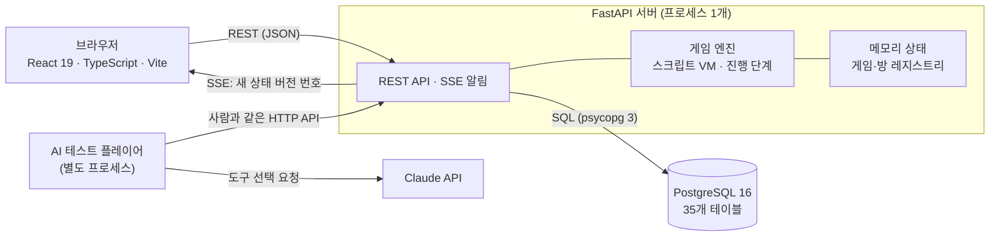

# 머더미스터리 제작·플레이 플랫폼

머더미스터리 시나리오를 웹에서 **제작**하고, 같은 사이트에서 온라인으로 함께 **플레이**하는 플랫폼이다. 제작 도구, 게임 엔진, 플레이 화면, 채팅, 관전, 그리고 시나리오 검증용 **AI 테스트플레이**로 이루어져 있다.

개인 프로젝트이며 배포 주소는 없다(내 컴퓨터에서 Docker 로 실행한다).

## 목차

1. [주제와 문제 정의](#1-주제와-문제-정의)
2. [구성도](#2-구성도)
3. [데이터 설계 (ERD)](#3-데이터-설계-erd)
4. [실행 방법](#4-실행-방법)
5. [결과와 해석](#5-결과와-해석)
6. [문제 해결](#6-문제-해결)
7. [역할분담](#7-역할분담) · [배포 주소](#8-배포-주소) · [문서 목록](#9-문서-목록)
10. [개발자용 상세](#10-개발자용-상세)

## 1. 주제와 문제 정의

**주제**: 머더미스터리는 참가자가 각자 인물을 맡아 단서를 모으고 대화하며 범인을 추리하는 게임이다. 이 프로젝트는 그 시나리오를 웹에서 만들고, 완성한 작품을 같은 사이트에서 온라인으로 진행하는 플랫폼을 만든다.

**문제 정의**

| # | 문제 | 이 프로젝트의 접근 |
|---|---|---|
| 1 | 한 작품은 인물별 서사, 장소, 단서, 증언, 진행 순서, 엔딩이 서로 참조한다. 문서나 표로 따로 관리하면 참조가 어긋난다. | 하나의 데이터 구조(35개 테이블)로 관리한다. 작품을 **확정**하면 스냅샷(버전)으로 고정되어, 플레이 중 수정이 섞이지 않는다. |
| 2 | 플레이어마다 볼 수 있는 정보가 달라야 한다. 자기 서사만 보이고, 남이 얻은 단서는 모르고, 밀담은 그 자리에 있던 사람만 읽는다. | 화면에서 숨기는 것이 아니라 **서버가 보는 사람별로 걸러서** 응답한다. 밀담은 보낸 시점의 수신자를 DB 에 저장한다. |
| 3 | 시나리오를 검증하려면 사람을 모아 한 판을 돌려야 한다. | **AI 테스트 플레이어**가 사람과 같은 API 로 한 판을 돌려, 진행이 끝까지 되는지 확인한다. |

**범위**

| 만든 것 | 만들지 않은 것 |
|---|---|
| 계정·로그인, 작품·인물·장소·단서·증언·사건·엔딩 제작, 진행 단계(흐름) 편집, 확정·버전 | 공개 서버 배포, 모바일에 맞춘 제작 화면 |
| 방 만들기·입장코드·대기실·관전(일반/GM), 게임 엔진(스크립트 VM), 캐릭터 선택·조사·토론·밀담·투표·엔딩 | 시나리오에 넣는 이미지(저장 테이블만 있음), 음성 대화(Discord 병행을 전제) |
| 게임 중 채팅(전체 + 밀담 A·B, 정원 2명), AI 테스트플레이 | 사람 대상 플레이 테스트 기록 |

## 2. 구성도



| 영역 | 사용 기술 |
|---|---|
| 백엔드 | Python 3.13, FastAPI(동기 엔드포인트), psycopg 3(SQL 직접 작성, 연결 풀), pydantic |
| DB | PostgreSQL 16, 마이그레이션 29개(`db/migrations`), 한글 테이블·컬럼 이름 |
| 프런트엔드 | React 19, TypeScript, Vite, openapi-fetch(API 타입 자동 생성) |
| 인증 | 비밀번호 Argon2 해시(pwdlib), 세션 토큰은 무작위 값의 SHA-256 만 저장 |
| 실시간 | 게임 상태는 SSE 로 "새 버전 번호"만 알리고 화면이 상태를 다시 조회, 채팅은 1.5초 간격 조회 |
| AI 테스트플레이 | Anthropic API(기본 `claude-haiku-5-5`), 모델 없이 도는 `--brain simple` 모드 |
| 시험·실행 | pytest, vitest, Playwright, Docker Compose |

| 디렉터리 | 내용 |
|---|---|
| `db/` | PostgreSQL 마이그레이션, 실행기, DB 테스트, ERD 생성 스크립트 |
| `backend/` | FastAPI 앱(`app/`), 스크립트(`scripts/`), 시험(`tests/`) |
| `frontend/` | React 앱 |
| `e2e/` | Playwright 브라우저 시험 |
| `docs/` | 설계 문서와 이미지 |

핵심 설계 결정: 진행 중인 게임·방 상태는 서버 **메모리**에 두고 투표·단서·채팅·엔딩 같은 기록은 DB 에 저장한다. 그래서 서버는 **프로세스 1개**로만 실행해야 한다(`docs/ENGINE_DESIGN.md`, `docs/DB_RULES.md`).

## 3. 데이터 설계 (ERD)

테이블 35개를 실제 DB 의 외래키에서 그렸다. 아래는 개요판이다(테이블 이름만, 작품·계정을 가리키는 연결선 일부는 생략).


모든 컬럼과 모든 연결선을 담은 **상세판**: [docs/images/erd_detail.png](docs/images/erd_detail.png) (PK·FK 표시, 작품·계정으로 향하는 연결선은 옅은 색).

- 제작 콘텐츠(인물·장소·단서 …)와 진행 흐름 테이블은 모두 `작품_번호` 로 작품에 소속된다.
- 작품을 확정하면 `버전` 테이블에 시나리오 스냅샷이 저장되고(수정 불가 트리거), 방과 게임 기록은 그 버전을 참조한다.
- 컬럼 전체·제약·인덱스는 [docs/SCHEMA_REFERENCE.md](docs/SCHEMA_REFERENCE.md), 설계 결정은 [docs/DB_RULES.md](docs/DB_RULES.md) 에 있다.
- ERD 다시 만들기(Graphviz 필요): `python3 db/scripts/gen_erd.py --dbname murder_mystery --out-dir docs/images`

## 4. 실행 방법

### 4-1. Docker (권장)

Docker Desktop 이 실행 중이어야 한다.

```bash
cp .env.example .env              # 선택: AI 테스트플레이에 Claude 를 쓸 때만 ANTHROPIC_API_KEY 를 채운다
docker compose up --build         # 서버·DB·샘플 작품까지 한 번에 실행
```

브라우저에서 **http://localhost:8000** 을 연다. 켤 때 샘플 작품 「동짓날 마을회관」(4인)이 자동으로 만들어져 "게임 목록"에 나온다. API 명세는 `/docs`.

### 4-2. AI 테스트플레이 (시나리오 검증)

1. 브라우저에서 방을 만든다. AI 로 4명을 모두 채우려면 **"방장도 플레이어로 참여"를 끄고**, 대기실에서 관전 방식을 **GM** 으로 바꾼다. 입장코드를 확인한다.
2. 다른 터미널에서 AI 를 입장시킨다.
   ```bash
   docker compose exec app python backend/scripts/ai_players.py --code <입장코드> --count 4
   ```
3. 방장이 게임을 시작한다. GM 관전이면 AI 들의 대화와 개인 정보를 모두 볼 수 있다.

Claude 호출에는 `ANTHROPIC_API_KEY` 가 필요하다(`.env`, 저장소에 올라가지 않는다). **키 없이 흐름만 확인하려면 `--brain simple`** 을 붙인다(모델 없이 규칙으로 움직이므로 말투와 추리는 살지 않는다).

### 4-3. 그 밖의 실행

자세한 Docker 명령 표, AI 옵션, 개발자용(백엔드·프런트 따로) 실행은 [10. 개발자용 상세](#10-개발자용-상세) 에 있다.

## 5. 결과와 해석

### 5-1. 실행 화면

아래 화면은 샘플 작품 「동짓날 마을회관」으로 방장(GM 관전) 1명, 사람 플레이어 1명, AI 3명(`--brain simple`)이 한 판을 끝까지 진행하며 캡처한 것이다. 1440×900.

| 화면 | 설명 |
|---|---|
|  | **플레이 홈**: 플레이할 수 있는 작품 목록과 입장코드 입력 |
|  | **제작 — 게임 흐름**: 진행 단계(페이즈) 카드로 게임 흐름을 만든다 |
|  | **대기실**: 입장코드, 참가자 4/4, 관전(GM), 게임 시작 |
|  | **캐릭터 선택**: 선착순으로 한 사람이 한 인물만 가진다. AI 선택 현황이 보인다 |
|  | **조사**: 장소별 단서·증언을 골라 얻는다. 얻은 사람 표시, 조사 횟수 제한 |
|  | **채팅(GM 관전, 크게 보기)**: 전체 + 밀담 A·B, 인물별 색. GM 은 모든 장소를 읽기 전용으로 본다 |
|  | **최종 투표**: 1인 1표 비공개, 다음 단계 전에는 바꿀 수 있고 완료 현황 4/4 |

> 채팅에 반복해서 보이는 "저는 아직 잘 모르겠어요."는 `--brain simple`(규칙 기반)의 고정 문장이다. Claude 를 연결하면 인물 설정을 프롬프트로 받아 대화하지만, 말투가 얼마나 유지되는지는 충분히 확인하지 못했다.

### 5-2. 검증 결과

2026-10-19 로컬 환경(PostgreSQL 16)에서 실행한 결과이다.

| 항목 | 결과 | 비고 |
|---|---|---|
| 백엔드 시험 (`pytest`, `backend/tests`) | **693 통과** | 임시 DB 를 만들어 실행 |
| DB 시험 (`pytest db/tests`) | **55 통과** | 마이그레이션, 제약, 트리거, 명세서 일치 |
| 프런트 시험 (`vitest`) | **243 통과** | |
| 브라우저 시험 (Playwright) | **53개 확인 통과** (`first_flow` 18, `full_flow` 31, `flow_drag` 4) | 실제 브라우저 3개로 진행. 이번에 낡은 시험 코드를 고쳤다(TROUBLESHOOTING 6). `e2e/README.md` |
| AI 테스트플레이 한 판 | 완주 | 위 5-1 캡처 때 확인. `--brain simple`, AI 3명 + 사람 플레이어 1명(브라우저 자동 조작) + GM 관전, 공통 스토리부터 전체 공개까지 9개 단계 |
| 규모 | 테이블 35, 마이그레이션 29, API 엔드포인트 50 | 엔드포인트는 라우터 정의 개수 |

### 5-3. 해석

- **보여주는 것**: 제작에서 확정, 방 생성, 입장, 게임 진행, 채팅, 투표, 엔딩까지 이어지는 흐름이 4인 한 판 기준으로 끝까지 동작한다. 정보 가시성 규칙(자기 서사만 보임, 밀담은 그 자리에 있던 사람만 읽음)과 선착순 선택 같은 동시성 규칙을 자동 시험이 확인한다.
- **보여주지 않는 것**:
  - 시험 통과는 기능이 규칙대로 동작한다는 뜻이지, 시나리오가 재미있거나 풀 수 있다는 뜻이 아니다. AI 테스트플레이로는 **진행이 막히지 않는지**를 확인할 수 있고, 재미와 난이도는 사람이 플레이해 봐야 안다. 이 저장소에는 사람 대상 플레이 테스트 기록이 없다.
  - `--brain simple` 한 판은 흐름 확인용이다. 실제 Claude 모델로는 소규모(4인) 실행에서만 확인했고, 장시간·다수 방에서의 품질과 비용은 확인하지 못했다.
  - 서버를 프로세스 1개로 실행해야 하고 DB 비밀번호가 개발용(`devpassword`)이라 **그대로 공개 서버에 올릴 수 없다**. 모바일 화면 배치는 보류했다.

## 6. 문제 해결

실제로 겪은 문제 6건의 증상·원인·해결 과정은 [TROUBLESHOOTING.md](TROUBLESHOOTING.md) 에 있다.

| # | 문제 |
|---|---|
| 1 | 같은 이름의 응답 모델 때문에 프런트엔드 타입이 깨짐 |
| 2 | 페이즈 카드를 끌기 시작할 때 다른 카드가 순간적으로 밀림 |
| 3 | AI 테스트 플레이어가 인물을 고르지 못하는데 로그에는 "성공"으로 보임 |
| 4 | AI 호출이 400 오류(크레딧 부족)로 반복 실패하고 멈춤 |
| 5 | 모두 확인·선택·투표를 마쳐도 다음 단계로 넘어가지 않음 |
| 6 | 기능을 더한 뒤 브라우저 시험이 조용히 낡아 실패함 |

## 7. 역할분담

1인 프로젝트로 진행했다(역할분담 생략). 구현은 AI 코딩 도구(Claude Code)와 협업했고, 설계 결정은 날짜와 함께 `docs/` 에 기록했다.

## 8. 배포 주소

없음. 로컬 Docker 실행만 지원한다(4-1 참고).

## 9. 문서 목록

| 문서 | 내용 |
|---|---|
| [TROUBLESHOOTING.md](TROUBLESHOOTING.md) | 겪은 문제와 해결 과정 |
| `.env.example` | 환경변수 이름 목록(값은 비어 있음) |
| [docs/SCHEMA_REFERENCE.md](docs/SCHEMA_REFERENCE.md) | 테이블별 컬럼·제약·인덱스·트리거(자동 추출) |
| [docs/DB_RULES.md](docs/DB_RULES.md) | DB 가 강제하는 규칙과 백엔드가 구현하는 규칙 |
| [docs/ENGINE_DESIGN.md](docs/ENGINE_DESIGN.md), [docs/ENGINE_SPEC.md](docs/ENGINE_SPEC.md) | 게임 엔진 설계와 명세 |
| [docs/EDITOR_DESIGN.md](docs/EDITOR_DESIGN.md) | 제작 도구 설계 |
| [docs/DEVELOPMENT_PLAN.md](docs/DEVELOPMENT_PLAN.md) | 개발 계획과 진행 상태 |
| [docs/BACKLOG.md](docs/BACKLOG.md) | 결정 기록과 보류 목록 |

## 10. 개발자용 상세

### Docker 로 한 번에 실행 (Windows 포함)

Docker Desktop 이 실행 중이어야 한다. 프로젝트 폴더에서 PowerShell 또는 터미널로:

```
docker compose up --build
```

처음에는 이미지를 만드느라 몇 분 걸린다. `데이터베이스 ... 마이그레이션 적용 ...  Uvicorn running` 이 보이면 브라우저에서 **http://localhost:8000** 을 연다. (화면과 API 가 같은 주소에서 나온다. API 명세는 `/docs`.)

| 하려는 일 | 명령 |
|---|---|
| 끄기 | `Ctrl+C`, 또는 다른 터미널에서 `docker compose down` (데이터는 남는다) |
| 다시 켜기 | `docker compose up` |
| 코드를 새로 받은 뒤(`git pull`) | `docker compose up --build` |
| 데이터까지 모두 지우고 처음부터 | `docker compose down -v` |
| 시연용 샘플 작품 | 켤 때 자동으로 만들어져 "게임 목록"에 「동짓날 마을회관」(4인)이 나온다. 수동 실행: `docker compose exec app python backend/scripts/seed_demo_work.py` |
| 내 계정을 운영자로 만들기 | `docker compose exec db psql -U postgres -d murder_mystery -c "UPDATE 계정 SET 권한 = '운영자' WHERE 아이디 = '내아이디'"` |

* 내 컴퓨터(`127.0.0.1`)에서만 열린다. 8000 번 포트가 이미 쓰이고 있으면 `docker-compose.yml` 의 `127.0.0.1:8000:8000` 앞 숫자를 바꾼다.
* 비밀번호(`devpassword`)는 개발용이다. 이 설정 그대로 인터넷에 공개하지 않는다.
* 이 방식은 서버 컨테이너가 하나(프로세스 하나)여야 대기실이 동작한다. 컨테이너 수를 늘리지 않는다.
* 개발자용 실행(아래)과 같은 PostgreSQL 이 이미 설치되어 있어도 충돌하지 않는다(DB 포트를 바깥에 열지 않는다).

### AI 테스트 플레이어 (상세)

AI 가 플레이어로 들어와 게임을 한다(`backend/scripts/ai_players.py`). Anthropic API 키가 필요하다.

1. 프로젝트 폴더에 `.env` 파일을 만들고 한 줄을 적는다(이 파일은 저장소에 올라가지 않는다). 모델은 `MM_AI_MODEL=...` 로 바꿀 수 있다.
   ```
   ANTHROPIC_API_KEY=sk-ant-...
   ```
2. `docker compose up --build` 로 켠다.
3. 브라우저에서 방을 만든다. AI 가 4명을 다 채우도록 **"방장도 플레이어로 참여"를 끄고**, 대기실에서 관전 방식을 **GM** 으로 바꾼다. 입장코드를 확인한다.
4. 다른 터미널에서 AI 를 입장시킨다(코드를 바꿔 넣는다).
   ```
   docker compose exec app python backend/scripts/ai_players.py --code 1234 --count 4
   ```
5. 방장이 게임을 시작하고 단계를 넘긴다. GM 관전이면 AI 들의 대화와 개인 정보를 모두 볼 수 있다. 끝나면 `Ctrl+C`.

키 없이 흐름만 보려면 `--brain simple` 을 붙인다(말투는 살지 않는다). `--verbose` 를 붙이면 AI 에게 준 글이 출력된다.

### 실행 (개발자용: 백엔드·프론트엔드를 따로)

접속 정보는 libpq 표준 환경변수를 따른다.

```bash
export PGHOST=127.0.0.1 PGPORT=5432 PGUSER=postgres PGPASSWORD=...

# 1) DB
createdb murder_mystery
python3 db/scripts/migrate.py --dbname murder_mystery

# 2) 백엔드 (http://127.0.0.1:8000, 명세: /docs)
cd backend && pip install -r requirements.txt
uvicorn app.main:app --port 8000          # DB 는 MM_DATABASE_URL 로 바꿀 수 있다 (기본: dbname=murder_mystery)

# 3) 프론트엔드 (http://localhost:5173, /api 는 8000 으로 프록시)
cd frontend && npm install
npm run dev
```

### 작업공간과 방 시험하기

작품 화면의 탭(개요 / 장소·단서 / 사건 / 관계·자료 / 진행 / 결말 / 확정)은 순서와 무관하게 채울 수 있다. 진행단계·기믹은 상단 "라이브러리"에서 만든다. **확정** 탭에서 확정하면 방을 만들 수 있다(방은 확정된 버전이 있는 작품으로만 만들 수 있다). 시험용으로 빈 스냅샷을 SQL 로 넣을 수도 있다.

```sql
INSERT INTO "버전" ("작품_번호", "버전", "시나리오") VALUES (<작품 번호>, '1.0', '{}'::jsonb);
```

대기실의 입장자 목록은 서버 메모리에 있으므로 백엔드는 **한 프로세스**로 실행해야 한다 (`uvicorn` 에 `--workers` 를 쓰지 않는다).

### 글꼴

앱 화면의 글꼴은 [Pretendard](https://github.com/orioncactus/pretendard)(SIL OFL 1.1)를 `npm` 패키지로 포함해서 기기마다 같게 보인다. 라이선스 문서는 `/licenses/Pretendard-OFL-1.1.txt` 로 함께 배포된다.
제작자가 시나리오(플레이 화면)에서 쓸 글꼴을 직접 올리는 기능은 아직 없다.

### 권한

`계정.권한`은 `사용자`(기본값) < `관리자` < `운영자` 3단계이다. 가입 API 로는 올릴 수 없고, 운영자·관리자 지정 기능은 아직 없다.
첫 운영자는 DB 에서 직접 지정한다.

```sql
UPDATE "계정" SET "권한" = '운영자' WHERE "아이디" = '내 아이디';
```

### 테스트
```bash
cd db/tests && python3 -m unittest discover -s . -p 'test_*.py'   # 약 100초, CREATEDB 권한 필요
cd backend && pip install -r requirements-dev.txt && pytest       # 임시 DB 를 만들어 사용
cd frontend && npm test && npm run typecheck
```

브라우저 시험(Playwright)은 서버가 떠 있어야 하며 실행법은 [e2e/README.md](e2e/README.md) 에 있다.

### API 타입 생성

백엔드 API 가 바뀌면 프론트 타입을 다시 생성해 `src/api/schema.d.ts` 를 함께 커밋한다.
backend 의존성이 설치된 Python 이 PATH 에 있어야 한다.

```bash
cd frontend && npm run gen:api
```

`typescript` 는 5.x 로 고정한다. `openapi-typescript` 가 TypeScript 5 의 컴파일러 API 를 쓰므로 7.x 에서는 동작하지 않는다.
